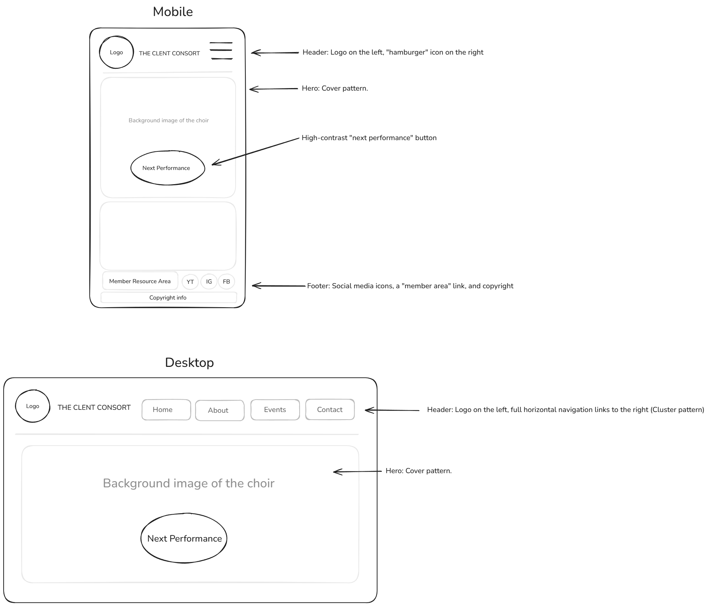
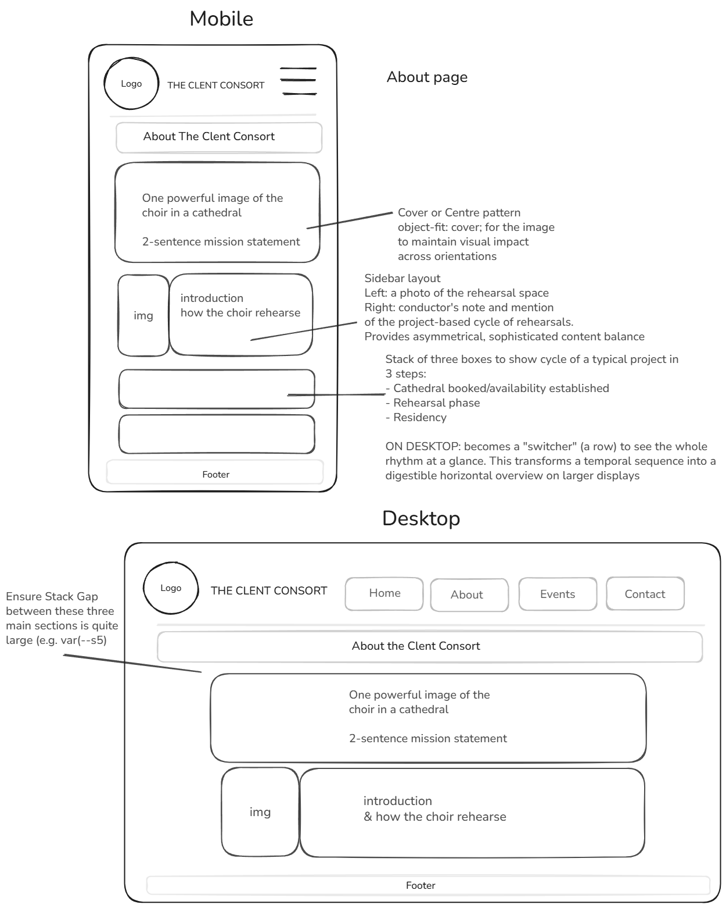
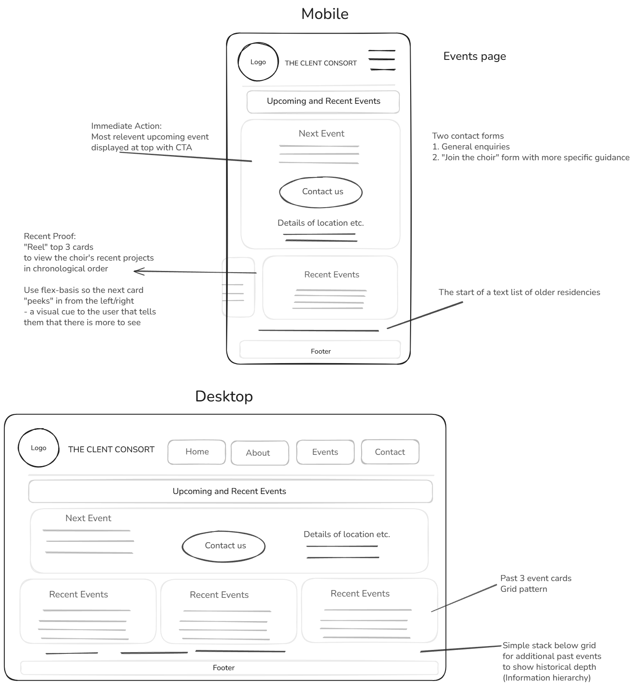
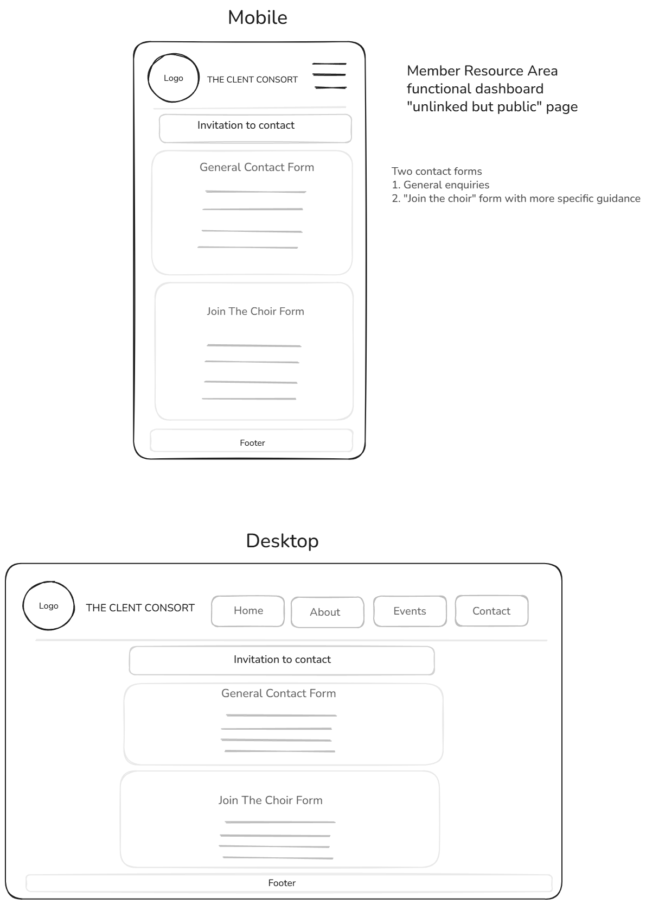
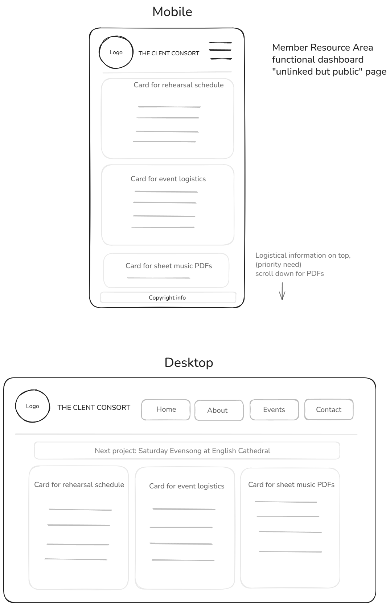

# UX design

[Back to README](../README.md)

I planned the site with Jesse James Garrett's five planes: strategy, scope, structure, skeleton and surface. This page covers each plane in turn, including how the design has changed since the first version.

## Contents

- [Research](#research)
- [Strategy](#strategy)
- [Scope](#scope)
- [Structure](#structure)
- [Skeleton](#skeleton)
- [Surface](#surface)
- [Phones first](#phones-first)
- [Accessibility](#accessibility)

## Research

Before designing anything, I looked at other ensembles' websites. Most offered concert dates, a few photos and a biography, and some had a press kit. Almost none had a working members' area: scores went out as email attachments, rehearsal changes went round as reply-all chains, and the treasurer kept a spreadsheet. The gap I set out to fill was one place that does both jobs: a credible public face, and a private hub for the choir's day-to-day running.

## Strategy

The site has two very different audiences, with a goal for each.

The outward-facing goal is to win residencies. The people who decide (deans, precentors, directors of music) are checking whether a visiting choir is reliable and musically serious. The public pages work as an electronic press kit: approach, track record, current repertoire and a way to make contact.

The inward-facing goal is to cut the admin. Singers need their schedule and music on a phone, often in a rehearsal room with a folder in the other hand. The committee needs to stop juggling spreadsheets and email threads.

[User stories](USER_STORIES.md) has the detailed needs and their MoSCoW priorities.

## Scope

I built the site in stages, each one usable on its own.

1. A static, responsive public site in semantic HTML and a hand-written CSS system: Home, About, Events and Contact.
2. The Django application: the same pages as templates, invite-only accounts, the members' dashboard and voice-part hubs, files on S3, the first committee tools (ledger, RSVP report, duty of care roster, documents, broadcasts) and the Django admin.
3. The October 2026 rebuild: one layout and navigation for the members' area; committee pages for everything that used to need the admin (events, polls, settings, members and invitations, the music library, broadcasts, the inbox); the practice player; a public Events page built from the schedule; and a mobile-first pass over the public site.

The [development log](DEVELOPMENT_LOG.md) has the full sequence.

## Structure

### Public site

| Visitor | Route |
| --- | --- |
| Concert-goer | Home, then Events (what's next, recent programmes, archive), then Contact |
| Cathedral or church staff | Home, then About (approach, the conductor's note, how a project runs), then Events (track record), then Contact to book |
| Prospective singer | Home, then About and Events, then the audition form on Contact |

A mistyped address gets a branded 404 page that leads back home, so there are no dead ends.

### Members' area

Every logged-in page shares one layout: a page heading, the members' navigation, then the page itself.

| Who | Navigation |
| --- | --- |
| Every member | Schedule (the dashboard), Repertoire (pieces and voice-part hubs), Looking Ahead (polls), Settings and the Document Vault |
| The committee, in addition | Hub, Inbox, Members, Projects, Music Library, Schedule, RSVPs, Polling, Financials, Documents, Broadcast, Duty of Care and Choir Settings |

On a desktop the navigation is a left sidebar. On a phone it is a sideways-scrolling strip of the member links, ending in a Committee button that opens the committee tools as a grid. My first version put all 18 links in the strip, and swiping through thirteen committee pills to reach Financials was too slow.

Sub-pages keep their parent marked as current, so editing a payment keeps Financials highlighted and a voice-part hub keeps Repertoire highlighted.

## Skeleton

These are the original wireframes for the public pages and the members' area.

| Home | About | Events |
| --- | --- | --- |
|  |  |  |

| Contact | Members |
| --- | --- |
|  |  |

A few principles have carried through every version since.

Progressive disclosure keeps the dashboard short. Each date is a collapsed card that opens to its RSVP, time, place and rehearsal plan. Past events fold into an "Earlier this project" section, and the subscription card only appears when something is owed.

Touch targets are at least 44 pixels, because singers mostly use the site on phones. That covers buttons, menu links and the RSVP selects.

Tables become cards on narrow screens. The committee's tables (ledger, roster, RSVP overview, members, music library) are real tables on wide screens, and below 45rem each row becomes a labelled card, with no JavaScript.

Destructive or irreversible actions ask first. Sending a broadcast needs a ticked confirmation as well as a dialog, and an email can only ever be sent once.

## Surface

The look borrows from the buildings the choir sings in.

| Element | Choice | Reason |
| --- | --- | --- |
| Dark cards | Charcoal, `#1a1a1a` | Reads like the inside of a stone church and gives the gold something to sit on |
| Pages | Stone neutrals and white | Keeps long pages light |
| Accent | Gold, `#c9a45e` | Candlelight and gilding; used on dark backgrounds |
| Gold on light backgrounds | Darker gold, `#8a6d34` | The brand gold reaches only 2.3:1 contrast on white, below the 4.5:1 that WCAG AA asks for body text. The darker gold reaches 4.9:1. |
| Headings | Cinzel | Classical Roman proportions, set in capitals with generous tracking |
| Body text | Inter | A high x-height and clear numerals, so dates, times and venues read instantly on a phone |
| Sizes | A fluid type and spacing scale built with `clamp()` | Generated from `design-tokens.json`, so it scales smoothly between phone and desktop without breakpoints |

## Phones first

The October 2026 pass reworked the public pages for phones.

- The home page photograph fills the first screen, with a short introduction and the next performance below it.
- The menu turns into a cross when open, with a solid panel and a dimmed page behind it.
- The Events button reads "Enquire" on one line, and the archive's year headings stay pinned while scrolling.
- The About page's background videos are not downloaded on phones; each slide offers a Play button instead. The same applies on any device set to reduce motion.
- The floating back-to-top button is hidden on phones, where it used to cover buttons and form fields.

[User journeys](USER_JOURNEYS.md) shows the result at 375 pixels wide.

## Accessibility

- Every page has one `h1`. On About it is visually hidden but present for screen readers.
- Every form field has a label, and groups of checkboxes are fieldsets with a legend.
- Decorative emoji are hidden from screen readers, and meaningful icons have text alternatives.
- Data tables have captions and column scope.
- Motion respects `prefers-reduced-motion`.

[Testing](TESTING.md) has the Lighthouse results and the template rules that the tests enforce.
